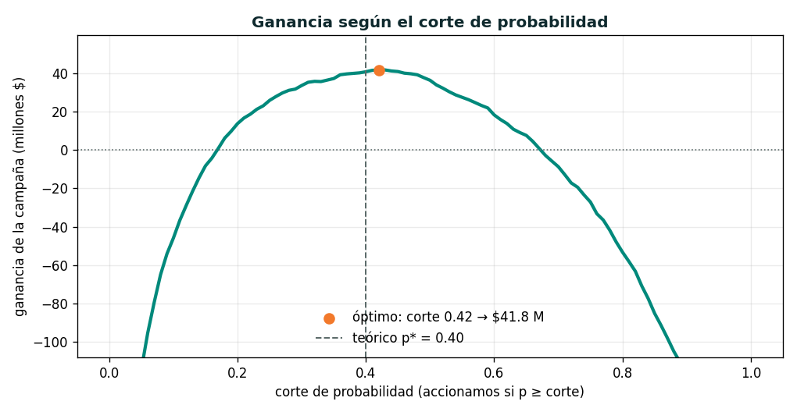

# Trabajo Final — Competencia de Modelado Predictivo

### Estadística Aplicada a la Investigación de Mercados — MGAIE · UNTREF
**Docentes:** Hugo Delfino · Gabriel Delfino

---

## 1. De qué se trata

Competencia estilo **Kaggle** con un problema real de un **banco**: predecir, para cada cliente, la **probabilidad de que se dé de baja** (*churn*) en los próximos meses, y —lo más importante— **decidir a quién accionar** para retenerlo, maximizando la **ganancia del banco**.

Entrenan sus modelos con la base etiquetada (`train.csv`), predicen sobre una base de validación que **no tiene la respuesta** (`test.csv`) y entregan **una única** predicción final. Nosotros la comparamos contra la verdad (que tenemos guardada) y comparamos las performances de todos los grupos.

---

## 2. La base

Datos reales (anonimizados) de clientes de un banco. Cada fila es **un cliente** en un momento dado, descripto por **176 variables** de sus productos y su actividad (tarjetas, cuentas, préstamos, cheques, cajeros, consumos, rentabilidad, etc.). La variable a predecir es **`ClaseBinaria`**: vale **1** si el cliente **se da de baja** en los dos meses siguientes a la foto de datos, y **0** si continúa. Alrededor del **22 %** son bajas (clases desbalanceadas → evaluamos con **AUC**, no con accuracy).

| Archivo | Qué es | Filas |
|---|---|---|
| `train.csv` | Datos **con** `ClaseBinaria` (0/1). Para entrenar (80%). | 109.908 |
| `test.csv` | Datos **sin** el target, con `Id`. Acá predicen (20%). | 27.477 |
| `sample_submission.csv` | Ejemplo del **formato de entrega**. | 27.477 |

### Cómo leer los nombres de las variables

| Convención | Significado | Ejemplo |
|---|---|---|
| Prefijo **`C…`** | **Cantidad** de operaciones/ítems | `CCHEQUES_EMITIDOS` = cantidad de cheques emitidos |
| Prefijo **`M…`** | **Monto** ($) | `MCHEQUES_EMITIDOS` = monto de los cheques emitidos |
| Prefijo **`T…`** | **Tenencia / uso** de un servicio | tiene o no ese producto/servicio |
| Sufijo **`…xesta`** | Ajustada por **estacionalidad** (comparable entre meses) | `VISA_MSALDODOLARESxesta` |
| Sufijo **`…xinfla`** | Ajustada por **inflación** (comparable en el tiempo) | `VISA_MSALDODOLARESxinfla` |

**Márgenes (lo que gana el banco con el cliente):** `MACTIVOS_MARGEN` = ganancia por **productos activos** (préstamos de todo tipo); `MPASIVOS_MARGEN` = ganancia por **productos pasivos** (depósitos, caja de ahorro, cuenta corriente); `MRENTABILIDAD` = rentabilidad del cliente. Muchas variables van agrupadas por producto (p. ej. las que empiezan con `VISA_…`).

> **Ojo con los datos (parte del trabajo):** algunas columnas de margen vienen con **formato mixto** y hay que convertirlas a numérico; conviene revisar tipos, valores extremos y variables casi constantes antes de modelar.

---

## 3. La tarea

Para **cada `Id` de `test.csv`**, predecir la **probabilidad** (número entre 0 y 1) de que `ClaseBinaria = 1`.

---

## 4. Formato de entrega (*submission*)

Un **CSV** con dos columnas: `Id` y `ClaseBinaria` (la probabilidad). Una fila por cada `Id` del test, **sin borrar ni reordenar**. Igual que `sample_submission.csv`:

```
Id,ClaseBinaria
3,0.02
7,0.94
9,0.11
...
```

**Una sola entrega final por grupo**, con el nombre `apellido_grupo.csv` (p. ej. `perez_g3.csv`). Se corrige todo junto al cierre y se comparan las performances.

---

## 5. Cómo se evalúa

Miramos **dos cosas**:

1. **Calidad del modelo — AUC-ROC** sobre el 20 % de validación. Mide qué tan bien el modelo **ordena** a los clientes por riesgo de baja (0,5 = azar; 1,0 = perfecto). Es la métrica de las clases 6–8.
   - **Referencias (esta base):** un modelo **básico** (regresión logística) ya llega a **~0,93**; Random Forest ~0,98; XGBoost ~0,99. **Umbral mínimo aprobatorio: AUC ≥ 0,90.**
2. **Decisión de negocio — ganancia** (sección 6): no alcanza con ordenar bien; hay que decidir **a quién accionar** y eso tiene un impacto en pesos.

---

## 6. Más allá del AUC: la decisión de negocio 💰

El banco no puede llamar a todos los clientes: **accionar cuesta**. La estrategia de retención es ofrecer una **bonificación del servicio por 2 meses** a los clientes que consideremos en riesgo. Cada decisión tiene un valor en pesos:

| Situación | Qué pasa | Valor |
|---|---|---|
| **Accionamos** y el cliente **se iba** | Lo retenemos: ganamos su margen, pagamos la bonificación | **+ $100.000 − $80.000 = +$20.000** |
| **Accionamos** y el cliente **no se iba** | Gastamos la bonificación al pedo | **− $80.000** |
| **No accionamos** y el cliente **se iba** | Se va sin que hagamos nada: perdemos su margen | **− $100.000** |
| **No accionamos** y el cliente **no se iba** | Todo bien | **$0** |

*(Parámetros: margen que se salva al retener = **$100.000**; costo de la bonificación = **$40.000/mes × 2 = $80.000**; margen perdido si se va sin acción = **$100.000**. Son editables.)*

Accionamos a los clientes cuya **probabilidad predicha ≥ un corte**. **¿Dónde ponés el corte?** Ahí está el juego:

- Corte **muy bajo** → accionás a casi todos → gastás fortunas en bonificaciones a gente que no se iba.
- Corte **muy alto** → no accionás casi a nadie → se te escapan los que sí se iban.
- Existe un **corte óptimo** que maximiza la ganancia. En teoría, **p\* = costo / (retener + perder) = 80.000 / 200.000 = 0,40** (¡no es 0,5!).

**Ejemplo con el baseline (XGBoost):**



- Corte **óptimo ≈ 0,42 → ganancia ≈ $41,8 millones**.
- Con corte 0,50 (el "por defecto") la ganancia baja a **$36,4 M**.
- Accionar a **todos** (corte 0) da una **pérdida enorme** (~ −$1.583 M).

Tienen el script **`ganancia.py`** para calcular esto sobre **su propia validación** (donde ustedes sí tienen la respuesta) y elegir el corte:

```
python ganancia.py --pred mi_validacion.csv --y mis_labels.csv --corte 0.42
```

---

## 7. Requisitos del modelado

1. **Aplicar al menos DOS técnicas** de la cursada y **compararlas**: árbol de decisión, Random Forest, XGBoost, red neuronal (MLP). Muy valorado: **optimización de hiperparámetros** (Clase 8) con validación cruzada.
2. **Preprocesamiento correcto:** convertir a numérico las columnas mixtas, tratar los códigos como categóricos cuando corresponda, estandarizar si usan red neuronal.
3. **Validá vos mismo:** separá un *hold-out* o usá *cross-validation* sobre el `train` para elegir el mejor modelo **y** el mejor corte de negocio. **Nunca** uses el `test` para entrenar ni decidir (*fuga de datos*).

---

## 8. Qué se entrega

1. **La predicción final** (`.csv` con el formato de la sección 4). **Una sola** por grupo.
2. **Notebook reproducible** (Python o R): mini-EDA, preprocesamiento, **≥ 2 modelos**, comparación con **curva ROC / AUC en su validación**, elección del modelo final, y el **análisis de ganancia** (curva de ganancia vs corte y el corte elegido).
3. **Informe corto (1–2 páginas):** qué probaron, variables más importantes, **el corte de probabilidad elegido y por qué**, y una **recomendación de negocio** (¿a cuántos clientes accionarían?, ¿cuánto ganarían?, ¿a quién priorizar?).

---

## 9. Criterios de evaluación (rúbrica sugerida)

| Criterio | Peso |
|---|---|
| Calidad del modelo — **AUC** en validación | 30 % |
| **Decisión de negocio** — ganancia lograda y justificación del corte | 25 % |
| Metodología correcta: validación sin fuga, uso apropiado de ≥ 2 técnicas | 25 % |
| Claridad, interpretación y reproducibilidad (notebook + informe) | 20 % |

---

## 10. Reglas

- Grupos de **2 a 3** integrantes.
- **Una única entrega final** por grupo (no hay reentregas).
- No se permiten **datos externos** ni usar el `test` para entrenar o para elegir el corte.
- **Fechas:** entrega de la predicción, el notebook y el informe hasta el **[fecha]**; defensa oral el **[fecha]**.

> **Pista para arrancar:** cargá `train.csv`, revisá tipos y convertí a numérico lo que haga falta, entrená un árbol y un Random Forest, mirá el AUC en un *hold-out*, y con `ganancia.py` sobre ese *hold-out* elegí el corte que maximiza la ganancia. Después probá XGBoost o una red, tuneá, y recién ahí generá tu predicción final sobre `test.csv`.

¡Éxitos! Cualquier duda con las variables o el formato, la evacuamos por el foro.
