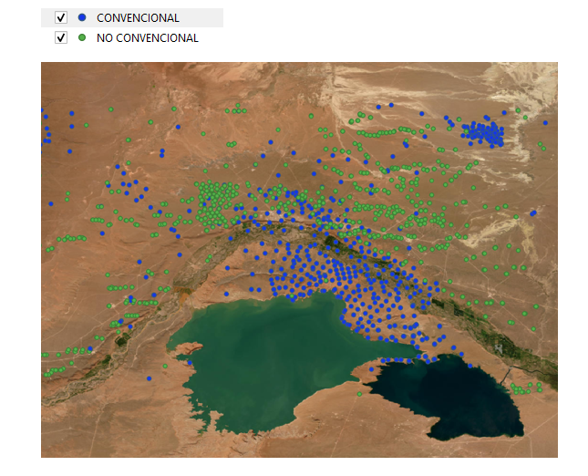

\newpage

## Objetivo del análisis

El objetivo del trabajo es evaluar si la profundidad, la antigüedad y la cota permiten clasificar un pozo como convencional o no convencional mediante análisis discriminante. Además, se comparan dos escenarios de probabilidades a priori: probabilidades iguales para ambos grupos y probabilidades basadas en la distribución observada de los pozos.

Como análisis complementario, se evalúa la capacidad de estas mismas variables para diferenciar la trayectoria de los pozos no convencionales, distinguiendo entre pozos horizontales y la categoría OTRA.

Las coordenadas geográficas se conservan para representar espacialmente los resultados y analizar posteriormente su relación con información de interferometría.


## Paquetes y datos de trabajo

```{python}
import numpy as np
import pandas as pd
import geopandas as gpd
import matplotlib.pyplot as plt
import seaborn as sns
import plotly.express as px


from sklearn.model_selection import train_test_split
from sklearn.preprocessing import StandardScaler
from sklearn.discriminant_analysis import LinearDiscriminantAnalysis
from sklearn.metrics import (
    confusion_matrix,
    classification_report,
    accuracy_score,
    balanced_accuracy_score
)

sns.set_theme(style="whitegrid")

json = "data/pozos_resultado.geojson"
gdf = gpd.read_file(json)
```

\newpage

# Análisis discriminante lineal según tipo de recurso

## Lectura de datos


```{python}

gdf["LONGITUD"] = gdf.geometry.x
gdf["LATITUD"] = gdf.geometry.y

print("Cantidad original de pozos:", len(gdf))
print()
print("Columnas disponibles:")
print(gdf.columns.tolist())


pd.set_option("display.max_columns", None)
gdf.head()
```

Se trabajó con una base georreferenciada de pozos petroleros. Cada registro corresponde a un pozo y contiene información sobre el tipo de recurso, profundidad, cota, antigüedad y localización geográfica.

## Preparación de las variables

La base analítica está compuesta por 3.044 pozos, con una observación por pozo. 
La variable de clasificación es `TIPO_RECUR`, que distingue entre 869 pozos 
convencionales y 2.175 no convencionales.

Para el análisis discriminante se utilizan tres variables cuantitativas: 
`PROFUNDIDAD_M`, `COTA_M` y `ANTIGUEDAD`. Los 3.044 registros cuentan con 
información completa para estas variables.

```{python}
datos = gdf.rename(columns={
    "field_7": "TIPO_RECUR",
    "field_8": "PROFUNDIDAD_M",
    "field_9": "COTA_M",
    "field_10": "FECHA_INICIO",
    "field_11": "ANTIGUEDAD"
}).copy()

datos["PROFUNDIDAD_M"] = pd.to_numeric(
    datos["PROFUNDIDAD_M"],
    errors="coerce"
)

datos["COTA_M"] = pd.to_numeric(
    datos["COTA_M"],
    errors="coerce"
)

datos["ANTIGUEDAD"] = pd.to_numeric(
    datos["ANTIGUEDAD"],
    errors="coerce"
)


variables = [
    "PROFUNDIDAD_M",
    "COTA_M",
    "ANTIGUEDAD"
]

datos_modelo = datos.dropna(
    subset=variables + ["TIPO_RECUR"]
).copy()

print("Pozos disponibles para el análisis:", len(datos_modelo))
print()
print(datos_modelo["TIPO_RECUR"].value_counts())
```

## Estadística descriptiva

```{python}
descriptiva = datos_modelo[variables].describe().T
descriptiva
```

```{python}
medias_grupo = (
    datos_modelo
    .groupby("TIPO_RECUR")[variables]
    .mean()
    .round(2)
)

print(medias_grupo)
```
Los grupos presentan diferencias claras en algunas de las variables analizadas. Los pozos convencionales tienen una profundidad media de 3.046,5 m y una antigüedad promedio de 26,2 años, mientras que los no convencionales alcanzan una profundidad media de 4.835,0 m y una antigüedad promedio de 7,1 años.

En cambio, la cota media es muy similar entre ambos grupos: 472,0 m para los pozos convencionales y 469,8 m para los no convencionales.

En términos preliminares, estas diferencias sugieren que la profundidad y la antigüedad podrían tener mayor capacidad discriminante, mientras que la cota tendría una contribución menor.


## Visualización tridimensional


```{python}
#| fig-width: 9
#| fig-height: 6
#| fig-align: center
#| 
fig = plt.figure(figsize=(9, 7))
ax = fig.add_subplot(111, projection="3d")

for grupo, df_grupo in datos_modelo.groupby("TIPO_RECUR"):
    ax.scatter(
        df_grupo["PROFUNDIDAD_M"],
        df_grupo["COTA_M"],
        df_grupo["ANTIGUEDAD"],
        label=grupo.title(),
        alpha=0.55,
        s=12)

ax.set_title(
    "Distribución de pozos según tipo de recurso",
    fontsize=14,
    pad=20)

ax.set_xlabel("Profundidad (m)", labelpad=10)
ax.set_ylabel("Cota (m)", labelpad=10)
ax.set_zlabel("Antigüedad (años)", labelpad=10)

ax.legend(
    title="Tipo de recurso",
    loc="upper left",
    bbox_to_anchor=(1.02, 0.90),
    frameon=True)

plt.tight_layout()
plt.show()
```


La representación conjunta de profundidad, cota y antigüedad permite observar la distribución de ambos grupos en el espacio definido por las tres variables. La separación visual se relaciona principalmente con la profundidad y la antigüedad, aunque existe cierto solapamiento entre las observaciones.


## División en entrenamiento y prueba

```{python}
X = datos_modelo[variables]
y = datos_modelo["TIPO_RECUR"]

X_train, X_test, y_train, y_test = train_test_split(
    X,
    y,
    test_size=0.30,
    random_state=123,
    stratify=y
)

print("Tamaño de entrenamiento:", len(X_train))
print("Tamaño de prueba:", len(X_test))
```

La base se dividió en un conjunto de entrenamiento y otro de prueba, manteniendo la proporción de pozos convencionales y no convencionales mediante una partición estratificada. El conjunto de entrenamiento se utilizó para estimar los modelos y el conjunto de prueba para evaluar su capacidad de clasificación.

## Estandarización de las variables

```{python}
scaler = StandardScaler()

X_train_scaled = scaler.fit_transform(X_train)
X_test_scaled = scaler.transform(X_test)

X_train_scaled = pd.DataFrame(
    X_train_scaled,
    columns=variables,
    index=X_train.index)

X_test_scaled = pd.DataFrame(
    X_test_scaled,
    columns=variables,
    index=X_test.index)
```

Las variables fueron estandarizadas antes de ajustar el modelo debido a que se encuentran expresadas en escalas diferentes. La transformación se estimó utilizando únicamente el conjunto de entrenamiento y luego se aplicó al conjunto de prueba.

## Modelo con probabilidades apriori iguales

Debido al diferente tamaño de los grupos, se plantearon dos escenarios de clasificación. En el primero se asignan probabilidades a priori iguales, de 50 % para cada grupo. Esto implica que, antes de considerar las características del pozo, ambos tipos de recurso tienen el mismo peso en la decisión de clasificación.

```{python}
lda_igual = LinearDiscriminantAnalysis(
    priors=[0.5, 0.5]
)

lda_igual.fit(X_train_scaled, y_train)

print("Clases:", lda_igual.classes_)
print("Probabilidades a priori:", lda_igual.priors_)
```

coeficientes

```{python}
coeficientes_igual = pd.Series(
    lda_igual.coef_[0],
    index=variables,
    name="Coeficiente"
)

coeficientes_igual
```
Los coeficientes de la función discriminante muestran que la antigüedad es la variable con mayor peso en la separación entre grupos, seguida por la profundidad. La contribución de la cota es considerablemente menor.

Probabilidades posteriores y clasificación:

```{python}
probabilidades_igual = lda_igual.predict_proba(X_test_scaled)
pred_igual = lda_igual.predict(X_test_scaled)

probabilidades_igual = pd.DataFrame(
    probabilidades_igual,
    columns=lda_igual.classes_,
    index=X_test.index
)

probabilidades_igual.head()
```

Evaluación del modelo

```{python}
matriz_igual = confusion_matrix(
    y_test,
    pred_igual,
    labels=lda_igual.classes_
)

matriz_igual = pd.DataFrame(
    matriz_igual,
    index=lda_igual.classes_,
    columns=lda_igual.classes_
)

matriz_igual
```

```{python}
print(classification_report(
    y_test,
    pred_igual
))

print(
    "Accuracy:",
    round(accuracy_score(y_test, pred_igual), 3)
)

print(
    "Balanced accuracy:",
    round(balanced_accuracy_score(y_test, pred_igual), 3)
)
```

## Modelo con probabilidades apriori observadas


En el segundo escenario se utilizan como probabilidades a priori las proporciones observadas en la muestra: aproximadamente 28,6 % para los pozos convencionales y 71,4 % para los no convencionales.

Este escenario incorpora como información previa la mayor presencia de pozos no convencionales en la base y permite evaluar cuánto modifica la clasificación respecto del modelo con probabilidades iguales.


```{python}
proporciones = (
    datos_modelo["TIPO_RECUR"]
    .value_counts(normalize=True)
    .reindex(["CONVENCIONAL", "NO CONVENCIONAL"])
)

proporciones
```

```{python}
lda_observado = LinearDiscriminantAnalysis(
    priors=proporciones.values
)

lda_observado.fit(X_train_scaled, y_train)

print("Clases:", lda_observado.classes_)
print("Probabilidades a priori:", lda_observado.priors_)
```

```{python}
coeficientes_observado = pd.Series(
    lda_observado.coef_[0],
    index=variables,
    name="Coeficiente"
)

coeficientes_observado
```

```{python}
probabilidades_observado = lda_observado.predict_proba(X_test_scaled)
pred_observado = lda_observado.predict(X_test_scaled)

probabilidades_observado = pd.DataFrame(
    probabilidades_observado,
    columns=lda_observado.classes_,
    index=X_test.index
)

probabilidades_observado.head()
```

```{python}
matriz_observado = confusion_matrix(
    y_test,
    pred_observado,
    labels=lda_observado.classes_
)

matriz_observado = pd.DataFrame(
    matriz_observado,
    index=lda_observado.classes_,
    columns=lda_observado.classes_
)

matriz_observado
```

```{python}
print(classification_report(
    y_test,
    pred_observado
))

print(
    "Accuracy:",
    round(accuracy_score(y_test, pred_observado), 3)
)

print(
    "Balanced accuracy:",
    round(balanced_accuracy_score(y_test, pred_observado), 3)
)
```

## Comparación de los modelos

El modelo con probabilidades a priori iguales presentó una exactitud del 93,1 % y una exactitud balanceada del 88,6 %. En comparación, el modelo con probabilidades a priori observadas alcanzó una exactitud del 89,1 % y una exactitud balanceada del 81,2 %.

Por lo tanto, en esta aplicación el modelo con probabilidades a priori iguales mostró un desempeño más equilibrado entre los dos grupos. Esto resulta especialmente relevante debido al desbalance existente en la base, compuesta por 869 pozos convencionales y 2.175 no convencionales.


```{python}
comparacion_modelos = pd.DataFrame({
    "Modelo": [
        "Prior iguales",
        "Prior observadas"
    ],
    "Accuracy": [
        accuracy_score(y_test, pred_igual),
        accuracy_score(y_test, pred_observado)
    ],
    "Balanced accuracy": [
        balanced_accuracy_score(y_test, pred_igual),
        balanced_accuracy_score(y_test, pred_observado)
    ]
})

comparacion_modelos.round(3)
```

La elección de las probabilidades a priori modifica la clasificación de algunos pozos. Al comparar ambos modelos, 43 observaciones cambian de grupo, lo que representa aproximadamente el 4,7 % del conjunto de prueba.

```{python}
cambios = pred_igual != pred_observado

print(
    "Pozos que cambian de clasificación:",
    cambios.sum()
)

print(
    "Porcentaje que cambia:",
    round(cambios.mean() * 100, 2),
    "%"
)
```

## Función discriminante

```{python}
#| output: asis

ld1 = lda_observado.transform(X_test_scaled)

resultados_test = datos_modelo.loc[X_test.index].copy()

resultados_test["LD1"] = ld1[:, 0]
resultados_test["REAL"] = y_test
resultados_test["PRED_IGUAL"] = pred_igual
resultados_test["PRED_OBSERVADO"] = pred_observado

resultados_test.head()
```

```{python}
plt.figure(figsize=(8, 5))

sns.histplot(
    data=resultados_test,
    x="LD1",
    hue="REAL",
    bins=30,
    alpha=0.6
)

plt.title("Distribución de la función discriminante según tipo de recurso")
plt.xlabel("Función discriminante (LD1)")
plt.ylabel("Frecuencia")

plt.tight_layout()
plt.show()
```

La función discriminante resume en una única dimensión la combinación de profundidad, cota y antigüedad que mejor separa los dos grupos.

Los coeficientes muestran que la antigüedad presenta el mayor peso discriminante, seguida por la profundidad, mientras que la cota tiene una participación reducida. En términos generales, los pozos más recientes y profundos tienden a ser clasificados como no convencionales, mientras que los de mayor antigüedad y menor profundidad tienden a corresponder al grupo convencional.

La distribución de LD1 permite visualizar la separación alcanzada por el modelo y también la zona de solapamiento donde aumenta la posibilidad de clasificación incorrecta.

## Clasificación de un pozo nuevo

Como aplicación del modelo, se evalúa un pozo hipotético con una profundidad de 4.000 m, una cota de 470 m y una antigüedad de 10 años. La comparación de las probabilidades posteriores obtenidas con ambos escenarios permite observar si la modificación de las probabilidades a priori cambia la clasificación asignada.


```{python}
pozo_nuevo = pd.DataFrame({
    "PROFUNDIDAD_M": [4000],
    "COTA_M": [470],
    "ANTIGUEDAD": [10]
})

pozo_nuevo_scaled = scaler.transform(pozo_nuevo)
```

Con prior iguales:

```{python}
#| warning: false
#| 
pred_nuevo_igual = lda_igual.predict(pozo_nuevo_scaled)
prob_nuevo_igual = lda_igual.predict_proba(pozo_nuevo_scaled)

print("Clasificación:", pred_nuevo_igual[0])
print(
    pd.Series(
        prob_nuevo_igual[0],
        index=lda_igual.classes_
    )
)
```

Y con prior observadas:

```{python}
#| warning: false

pred_nuevo_observado = lda_observado.predict(pozo_nuevo_scaled)
prob_nuevo_observado = lda_observado.predict_proba(pozo_nuevo_scaled)

print("Clasificación:", pred_nuevo_observado[0])
print(
    pd.Series(
        prob_nuevo_observado[0],
        index=lda_observado.classes_
    )
)
```

## Distribución espacial de los pozos

Como complemento del análisis estadístico, se presenta la distribución espacial de los pozos convencionales y no convencionales. Las coordenadas no se utilizaron como variables explicativas del modelo, pero permiten observar la localización de ambos grupos y vincular posteriormente los resultados con otras capas de información geográfica.




## Exportación de resultados

```{python}
resultados_test.to_csv(
    "data/resultados_clasificacion.csv",
    index=False
)
```

```{python}
resultados_geo = gdf.loc[resultados_test.index].copy()

resultados_geo["LD1"] = resultados_test["LD1"]
resultados_geo["PRED_IGUAL"] = resultados_test["PRED_IGUAL"]
resultados_geo["PRED_OBSERVADO"] = resultados_test["PRED_OBSERVADO"]

resultados_geo.to_file(
    "data/resultados_clasificacion.geojson",
    driver="GeoJSON"
)
```


# Análisis discriminante según trayectoria 

Como análisis complementario se estudia la trayectoria de los pozos no convencionales. Dado que la base utilizada no contiene una variable específica de trayectoria, se identificaron como horizontales aquellos pozos cuya sigla incluye la marca (h). Los restantes casos se agruparon en la categoría OTRA.

Por lo tanto, este análisis distingue entre HORIZONTAL y OTRA a partir de la información disponible en la sigla.

##  Preparación de los datos

```{python}
datos_trayectoria = gdf.rename(columns={
    "field_2": "SIGLA",
    "field_7": "TIPO_RECUR",
    "field_8": "PROFUNDIDAD_M",
    "field_9": "COTA_M",
    "field_10": "FECHA_INICIO",
    "field_11": "ANTIGUEDAD"
}).copy()
datos_trayectoria["PROFUNDIDAD_M"] = pd.to_numeric(
    datos_trayectoria["PROFUNDIDAD_M"], errors="coerce"
)

datos_trayectoria["COTA_M"] = pd.to_numeric(
    datos_trayectoria["COTA_M"], errors="coerce"
)

datos_trayectoria["ANTIGUEDAD"] = pd.to_numeric(
    datos_trayectoria["ANTIGUEDAD"], errors="coerce"
)

datos_trayectoria = datos_trayectoria[
    datos_trayectoria["TIPO_RECUR"] == "NO CONVENCIONAL"
].copy()
```


```{python}
datos_trayectoria["TRAYECTORIA"] = np.where(
    datos_trayectoria["SIGLA"].str.contains(
        r"\(h\)",
        case=False,
        na=False
    ),
    "HORIZONTAL",
    "OTRA"
)
```


```{python}
variables_trayectoria = [
    "PROFUNDIDAD_M",
    "COTA_M",
    "ANTIGUEDAD"
]

datos_modelo_trayectoria = datos_trayectoria.dropna(
    subset=variables_trayectoria + ["TRAYECTORIA"]
).copy()

print("Pozos disponibles para el análisis:", len(datos_modelo_trayectoria))
print()
print(datos_modelo_trayectoria["TRAYECTORIA"].value_counts())
```
El análisis se restringió a los 2.175 pozos no convencionales. A partir de la información contenida en la sigla se identificaron 1.665 pozos horizontales y 510 agrupados en la categoría OTRA.

Los casos seleccionados cuentan con información completa en profundidad, cota y antigüedad, por lo que no fue necesario eliminar observaciones adicionales para ajustar el modelo.

## Estadística descriptiva

```{python}
medias_trayectoria = (
    datos_modelo_trayectoria
    .groupby("TRAYECTORIA")[variables_trayectoria]
    .mean()
    .round(2)
)

print(medias_trayectoria)
```
Los pozos horizontales presentan una profundidad media de 5.406,71 m, mientras que los clasificados como OTRA alcanzan 2.968,41 m. También se observa una diferencia en la antigüedad: los horizontales tienen en promedio 5,46 años y los restantes 12,63 años.

La cota media presenta una diferencia menor, con 460,94 m para los horizontales y 498,78 m para la categoría OTRA.

Estas diferencias sugieren que la profundidad y la antigüedad podrían tener mayor capacidad para discriminar entre ambas categorías.

## Cantidad de pozos según trayectoria

```{python}
conteo_trayectoria = (
    datos_modelo_trayectoria["TRAYECTORIA"]
    .value_counts()
)

plt.figure(figsize=(6, 4))

conteo_trayectoria.plot(
    kind="bar"
)

plt.title("Cantidad de pozos según trayectoria")
plt.xlabel("Trayectoria")
plt.ylabel("Cantidad de pozos")

plt.xticks(rotation=0)
plt.tight_layout()
plt.show()
```

La distribución de los casos muestra un predominio de pozos horizontales dentro del conjunto de pozos no convencionales. Se identificaron 1.665 pozos horizontales y 510 clasificados como OTRA.

Esta diferencia en el tamaño de los grupos debe considerarse al evaluar el desempeño del modelo, ya que una medida global de exactitud puede verse influida por la categoría más numerosa.


## Profundidad según trayectoria

```{python}
plt.figure(figsize=(7, 5))

sns.boxplot(
    data=datos_modelo_trayectoria,
    x="TRAYECTORIA",
    y="PROFUNDIDAD_M"
)

plt.title("Profundidad según trayectoria")
plt.xlabel("Trayectoria")
plt.ylabel("Profundidad (m)")

plt.tight_layout()
plt.show()
```

La distribución de la profundidad muestra una diferencia marcada entre ambas categorías. Los pozos horizontales presentan, en general, mayores profundidades que los clasificados como OTRA.

Este patrón es consistente con las estadísticas descriptivas, donde la profundidad media de los pozos horizontales alcanza 5.406,71 m frente a 2.968,41 m en la categoría OTRA. Por lo tanto, la profundidad aparece como una variable relevante para discriminar entre ambas trayectorias.


## División en entrenamiento y prueba

```{python}
X_tray = datos_modelo_trayectoria[variables_trayectoria]
y_tray = datos_modelo_trayectoria["TRAYECTORIA"]

X_train_tray, X_test_tray, y_train_tray, y_test_tray = train_test_split(
    X_tray,
    y_tray,
    test_size=0.30,
    random_state=123,
    stratify=y_tray
)

print("Tamaño de entrenamiento:", len(X_train_tray))
print("Tamaño de prueba:", len(X_test_tray))
print()
print(y_train_tray.value_counts())
print()
print(y_test_tray.value_counts())
```
Para evaluar el desempeño del modelo, los datos se dividieron en un conjunto de entrenamiento y otro de prueba. La partición se realizó de forma estratificada, de modo que ambos conjuntos conservaran aproximadamente la misma proporción de pozos horizontales y de la categoría OTRA.


## Estandarización de las variables

```{python}
scaler_tray = StandardScaler()

X_train_tray_scaled = scaler_tray.fit_transform(X_train_tray)
X_test_tray_scaled = scaler_tray.transform(X_test_tray)

X_train_tray_scaled = pd.DataFrame(
    X_train_tray_scaled,
    columns=variables_trayectoria,
    index=X_train_tray.index
)

X_test_tray_scaled = pd.DataFrame(
    X_test_tray_scaled,
    columns=variables_trayectoria,
    index=X_test_tray.index
)
```

La profundidad, la cota y la antigüedad se expresan en escalas diferentes, por lo que fueron estandarizadas antes de ajustar el análisis discriminante. La transformación se estimó utilizando el conjunto de entrenamiento y luego se aplicó al conjunto de prueba.


## Modelo discriminante de trayectoria

```{python}
lda_tray = LinearDiscriminantAnalysis()
lda_tray.fit(X_train_tray_scaled, y_train_tray)

print("Clases:", lda_tray.classes_)
print("Probabilidades a priori:", lda_tray.priors_)
```


```{python}
coeficientes_tray = pd.Series(
    lda_tray.coef_[0],
    index=variables_trayectoria,
    name="Coeficiente"
)

print(coeficientes_tray)
```
Los coeficientes de la función discriminante muestran que la antigüedad es la variable con mayor peso en la separación entre las categorías, con un coeficiente de 2,576. Le sigue la profundidad, con un coeficiente de −1,858, mientras que la cota presenta una contribución mucho menor, con un coeficiente de −0,088.

Estos resultados son consistentes con las estadísticas descriptivas: los pozos horizontales son, en promedio, más profundos y más recientes que los incluidos en la categoría OTRA.

## Evaluación del modelo

```{python}
pred_tray = lda_tray.predict(X_test_tray_scaled)

matriz_tray = confusion_matrix(
    y_test_tray,
    pred_tray,
    labels=lda_tray.classes_
)

matriz_tray = pd.DataFrame(
    matriz_tray,
    index=lda_tray.classes_,
    columns=lda_tray.classes_
)

print(matriz_tray)
```


```{python}
print(classification_report(y_test_tray, pred_tray))

print("Accuracy:",
      round(accuracy_score(y_test_tray, pred_tray), 3))

print("Balanced accuracy:",
      round(balanced_accuracy_score(y_test_tray, pred_tray), 3))
```
El modelo alcanzó una exactitud del 93,4 % y una exactitud balanceada del 95,0 %, lo que indica un buen desempeño incluso considerando la diferencia en el tamaño de los grupos.

De los 500 pozos horizontales incluidos en el conjunto de prueba, 460 fueron correctamente clasificados y 40 fueron asignados a la categoría OTRA. Entre los 153 pozos de la categoría OTRA, 150 fueron correctamente identificados y solo 3 fueron clasificados como horizontales.

La mayor parte de los errores corresponde, por lo tanto, a pozos horizontales clasificados como OTRA.

## Función discriminante


```{python}
ld1_tray = lda_tray.transform(X_test_tray_scaled)

resultados_tray = datos_modelo_trayectoria.loc[
    X_test_tray.index
].copy()

resultados_tray["LD1"] = ld1_tray[:, 0]
resultados_tray["REAL"] = y_test_tray
resultados_tray["PREDICHO"] = pred_tray
```


```{python}

plt.figure(figsize=(8, 5))

sns.histplot(
    data=resultados_tray,
    x="LD1",
    hue="REAL",
    bins=30,
    alpha=0.6
)

plt.title("Distribución de la función discriminante según trayectoria")
plt.xlabel("Función discriminante (LD1)")
plt.ylabel("Frecuencia")

plt.tight_layout()
plt.show()


```
La distribución de la función discriminante LD1 muestra una separación clara entre los pozos horizontales y los clasificados como OTRA, aunque existe una zona de solapamiento entre ambas categorías.

Esta separación es coherente con el buen desempeño observado en la matriz de confusión y con la importancia de la antigüedad y la profundidad en la función discriminante.


## Exportación de resultados

```{python}
resultados_tray.to_csv(
    "data/resultados_trayectoria.csv",
    index=False
)
```


```{python}
resultados_tray_geo = gdf.loc[resultados_tray.index].copy()

resultados_tray_geo["TRAYECTORIA"] = resultados_tray["TRAYECTORIA"]
resultados_tray_geo["LD1"] = resultados_tray["LD1"]
resultados_tray_geo["REAL"] = resultados_tray["REAL"]
resultados_tray_geo["PREDICHO"] = resultados_tray["PREDICHO"]

resultados_tray_geo.to_file(
    "data/resultados_trayectoria.geojson",
    driver="GeoJSON"
)
```

Finalmente, los resultados del análisis de trayectoria se exportaron en formato tabular y geoespacial, incluyendo la categoría observada, la predicción del modelo y la puntuación discriminante LD1. Esto permite reutilizar los resultados en análisis posteriores y en herramientas de información geográfica.

# Conclusiones

El análisis discriminante lineal permitió diferenciar los pozos convencionales y no convencionales a partir de la profundidad, la cota y la antigüedad. Las principales diferencias entre ambos grupos se observaron en la profundidad y la antigüedad: los pozos no convencionales resultaron, en promedio, más profundos y más recientes que los convencionales. En cambio, la cota presentó valores medios similares entre ambos grupos.

Los coeficientes de la función discriminante mostraron que la antigüedad tuvo el mayor peso en la separación de los grupos, seguida por la profundidad, mientras que la cota presentó una contribución comparativamente menor.

La comparación de los dos escenarios de probabilidades a priori mostró que el modelo con probabilidades iguales alcanzó una clasificación más equilibrada que el modelo basado en las proporciones observadas. Esto resulta relevante debido al desbalance existente entre los pozos convencionales y no convencionales.

En el análisis complementario de trayectoria, los pozos identificados como horizontales se caracterizaron por presentar mayores profundidades y menor antigüedad que los agrupados en la categoría OTRA. El modelo alcanzó una exactitud del 93,4 % y una exactitud balanceada del 95,0 %, mostrando una buena capacidad de separación entre ambas categorías.

Finalmente, la representación cartográfica complementa el análisis estadístico al permitir observar la distribución espacial de los pozos y deja abierta la posibilidad de integrar estos resultados con otras fuentes de información geográfica, como productos derivados de interferometría.
